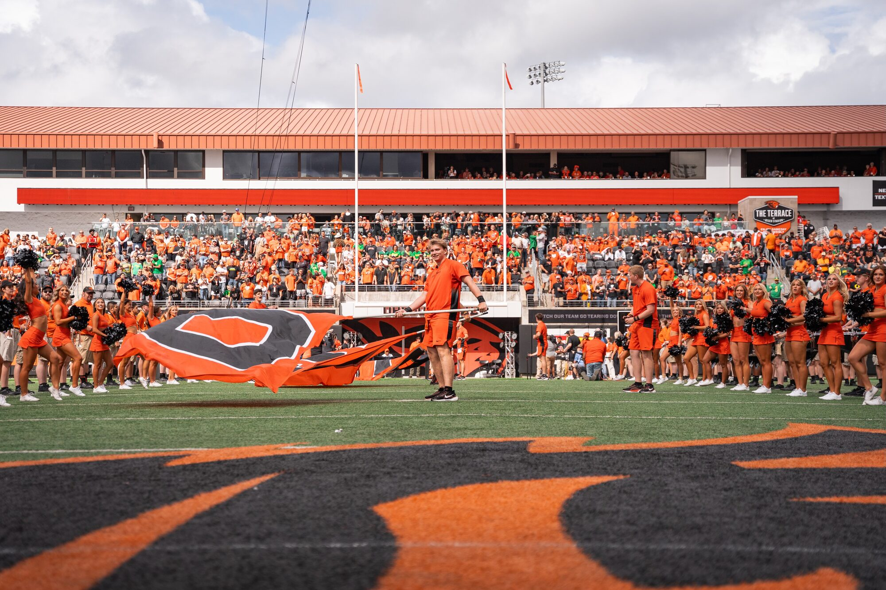
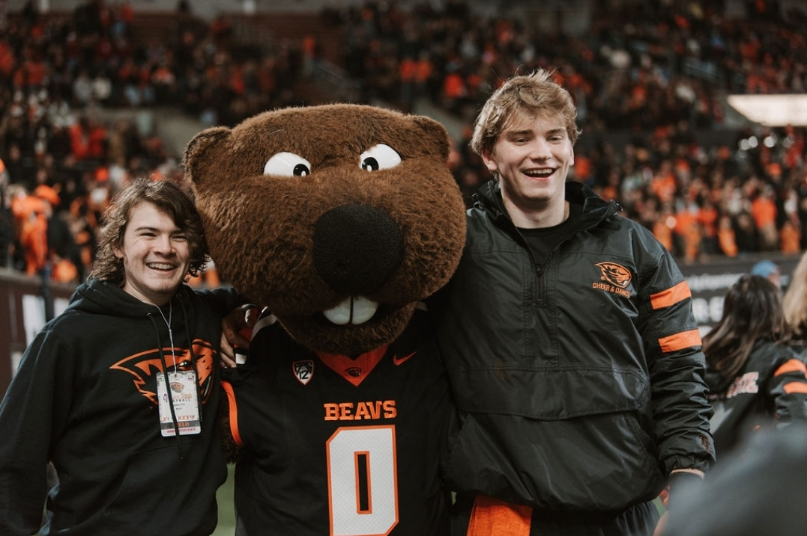
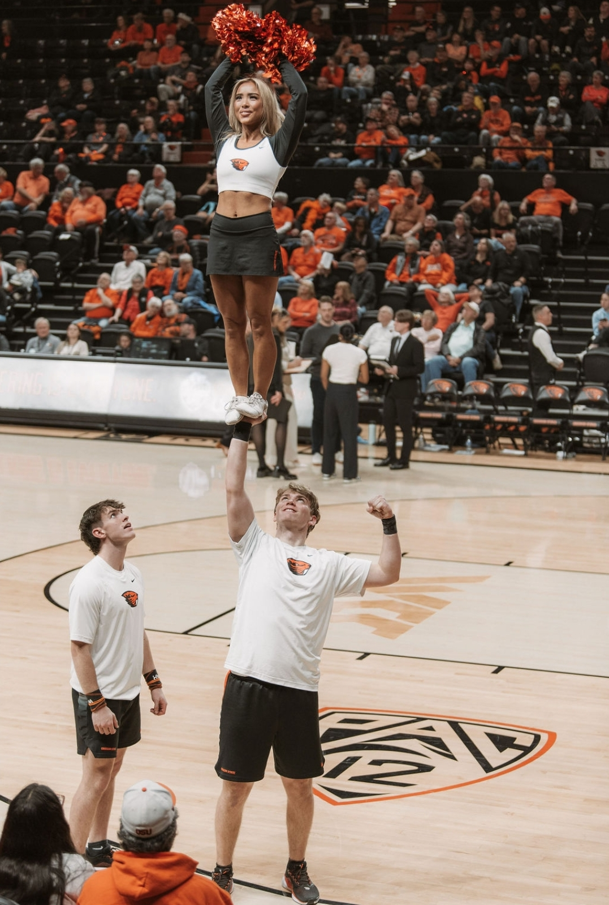
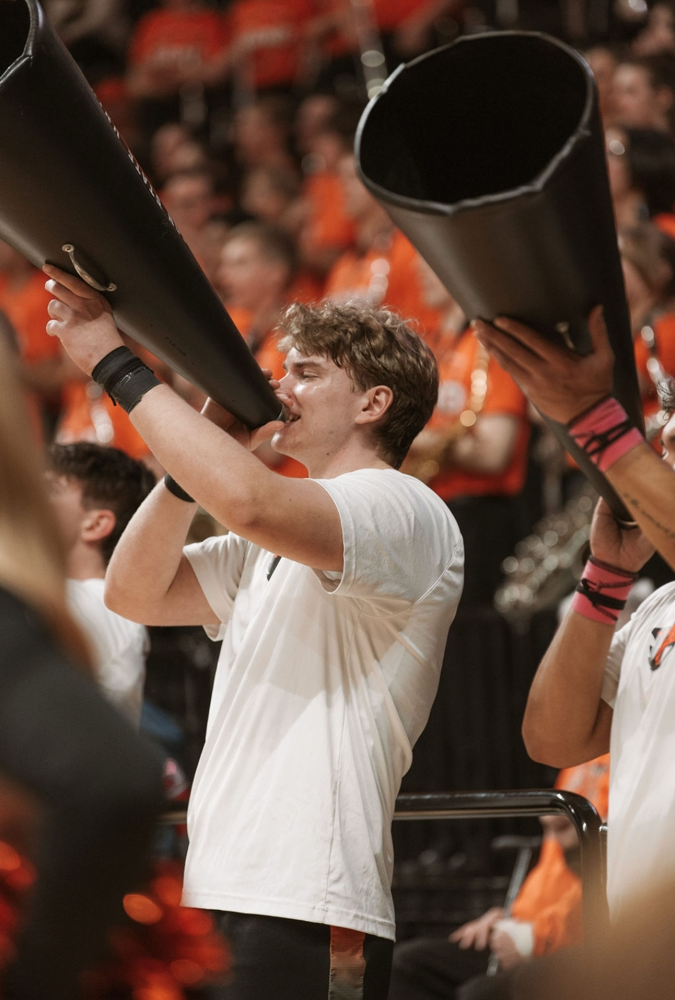
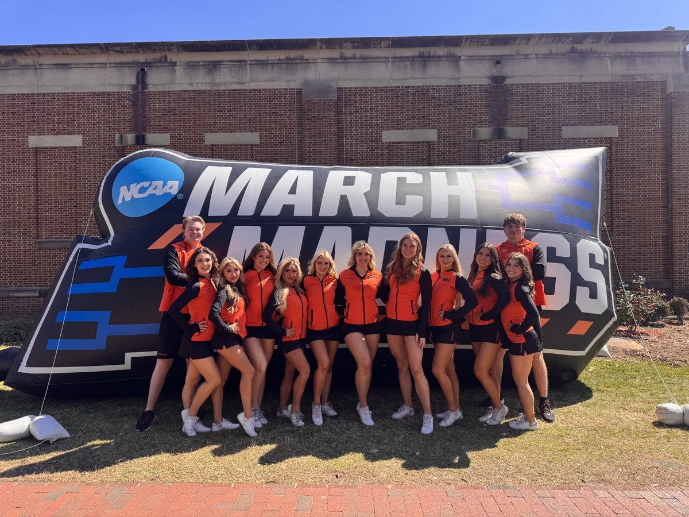
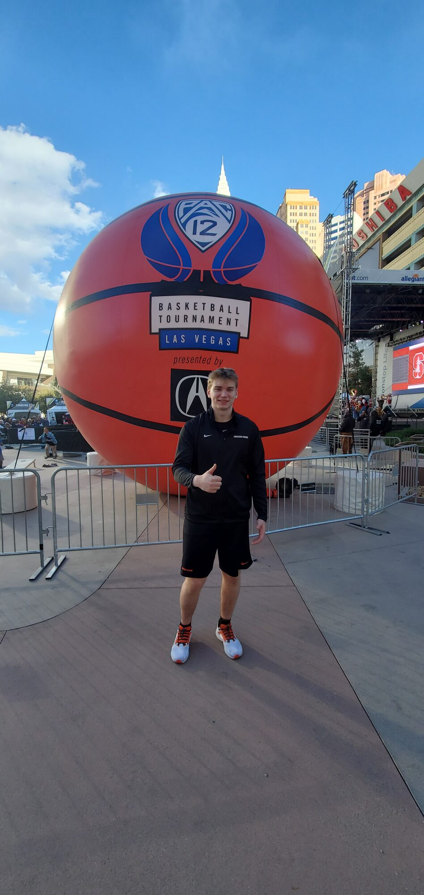
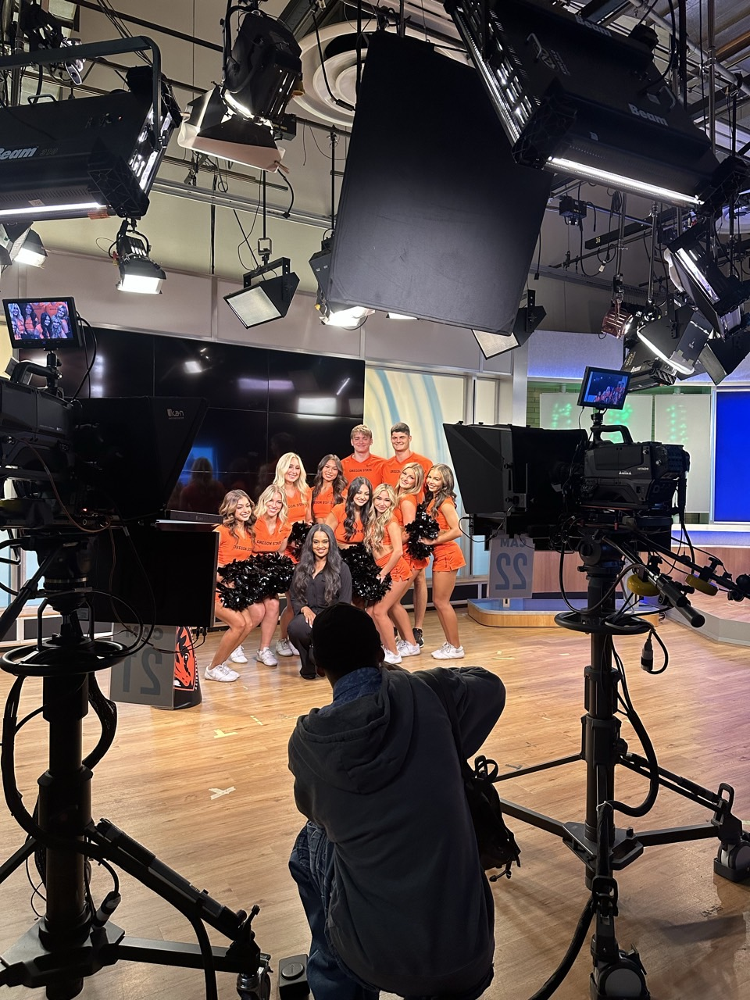
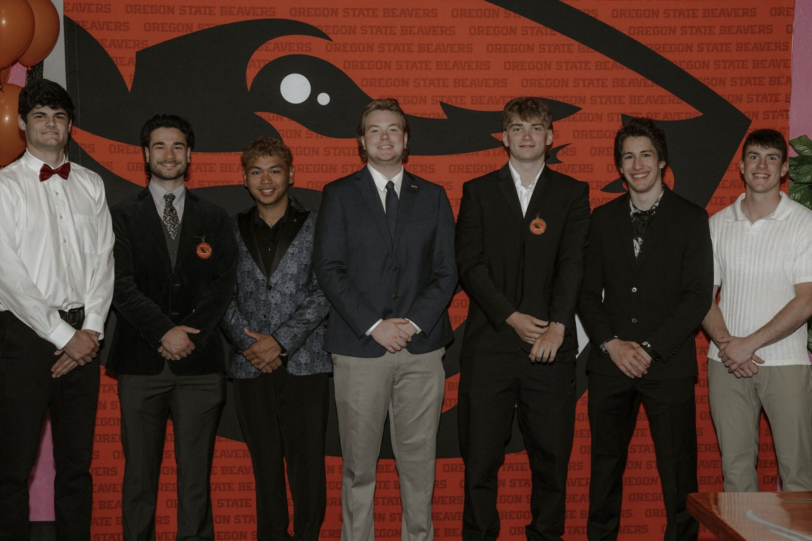
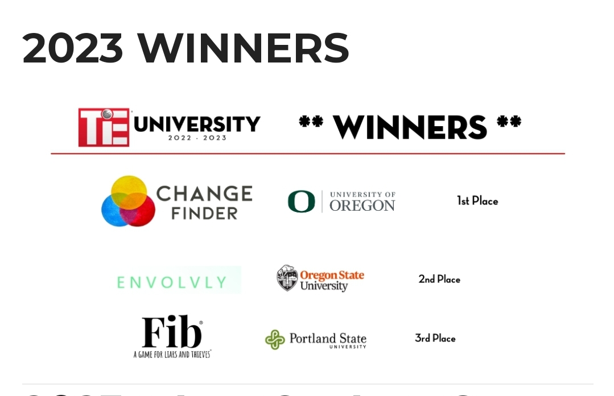

# Oregon State University — B.S. Computer Science

## 1. Snapshot
James earned a **B.S. in Computer Science** with a focus in Machine Learning & AI and a **minor in Cybersecurity** in June 2026, graduating **Cum Laude** and making the **Dean's List**. Alongside the degree he:
- trained and performed as an **NCAA Division I cheerleader** (base/stunt) for 20+ hours a week, year-round, from Feb 2023 to Jun 2026;
- held several concurrent internships;
- co-founded **Envolvly**, which won OSU's school-wide startup pitch competition.

His senior capstone was **OpenBeavs**, the university's AI-agent platform.

## 2. Headline numbers
| Item | Value | Tag |
|---|---|---|
| Honors | Cum Laude · Dean's List · Honor Roll | 🟢 |
| GPA | 3.5+ | 🟢 |
| D1 athletics | 20+ hrs/week year-round, Feb 2023 → Jun 2026; football (Reser Stadium), men's & women's basketball (Gill Coliseum), wrestling, volleyball; women's basketball at March Madness, Pac-12 men's basketball tournament | 🟢 |
| Pitch competition | Won OSU's school-wide startup pitch competition with Envolvly | 🟢 |
| Capstone | OpenBeavs: 57% of core-repo commits, 28 of 49 merged PRs | ✅ |

## 3. Highlights
- **Senior capstone:** [OpenBeavs](../../project/openbeavs/brag.md), a four-person team building OSU's A2A agent hub.
- **Coursework and labs:** see [coursework](../../project/coursework/brag.md), which covers MIT JOS kernel labs, network security, digital forensics, CS 361 SCRUM lead, ML, cloud and more.
- **Relevant coursework:** Machine Learning, Deep Learning, Data Mining, Artificial Intelligence, Analysis of Algorithms, Data Structures, Operating Systems I & II, Software Engineering I & II, Databases, Mathematical Statistics (ST 421/521), Vector Calculus, Linear Algebra, Network Security (ECE/CS 478), Digital Forensics (CS 473), Sentiment Analysis/NLP (CS 331), Computer Assembly, Technical Writing.
- **Activities:** NCAA D1 Beaver Cheer, SADEV, BeaverHacks, ACM@OSU, and community service at DAM Able and DAM Proud Day.

## 4. Earlier leadership
- Founded and led the gaming club at Tigard High School (2018–2022).
- Rotary Club public-speaking award; OGPC competitor.

## 5. Resume-ready bullets
- B.S. Computer Science (ML & AI focus), Cybersecurity minor, Oregon State University, June 2026: Cum Laude, Dean's List.
- NCAA Division I student-athlete (cheer, base/stunt) training 20+ hours per week while completing multiple concurrent internships.
- Won Oregon State's school-wide startup pitch competition (Envolvly).

## 6. Soundbites
- "Yes, I'm the big guy throwing people in the air. Being a base taught me more about trust and timing than any group project."

## 7. Photos
| | |
|---|---|
|  |  |
|  |  |
|  |  |
|  |  |
|  | |

Logo: `assets/logo.png`
