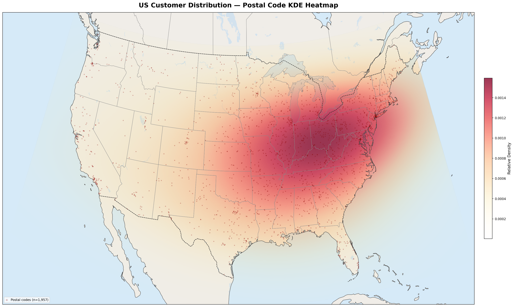
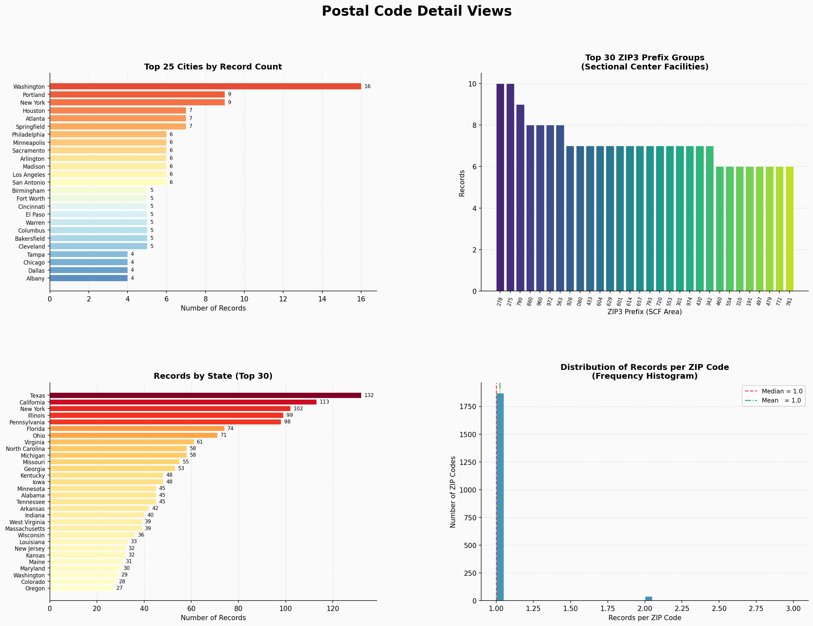

# Carrick FC — Data Analyst

<!-- hero -->

*Fan-demographics heat map built for Carrick FC (mock data).*

## 1. Snapshot
James did part-time, remote data and automation work for a football club. He built **N8N workflows** for club operations, including newsletters that are generated and sent automatically and a **certificate-generation automation**. He also ran **sentiment analysis and demographic research** to guide fan engagement and communications, wrote a sentiment brief and investor-facing material ("Invest Carrick"), and **filmed and edited the club's 2025 promotional videos**.

## 2. Headline numbers
| Number | Source |
| --- | --- |
| **3 promotional videos** filmed and edited (Nov 2025) | club promo folder |

## 3. Resume-ready bullets
- Built N8N automation workflows for club operations, including automated newsletter generation and distribution and certificate generation.
- Performed sentiment analysis and demographic research to inform fan-engagement and communications strategy.
- Filmed and edited the club's 2025 promotional videos.

## 4. Data visualizations (mock data)
The supporter-demographics pipeline, re-rendered on **mock data** so it can be shown publicly: a U.S. postal-code **KDE density heat map**, and a four-panel detail view (top 25 cities, top 30 ZIP3 prefix groups, records by state, records per ZIP). The figures in these images are synthetic.

## 5. Keywords
N8N, workflow automation, sentiment analysis, NLP, demographic analysis, geospatial visualization, KDE heat maps, matplotlib, newsletters, video filming & editing, sports marketing, data analysis.
