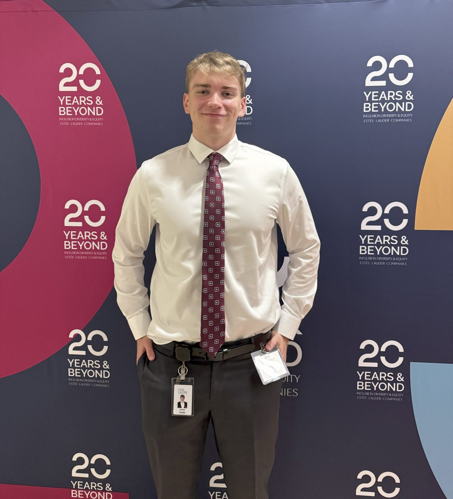
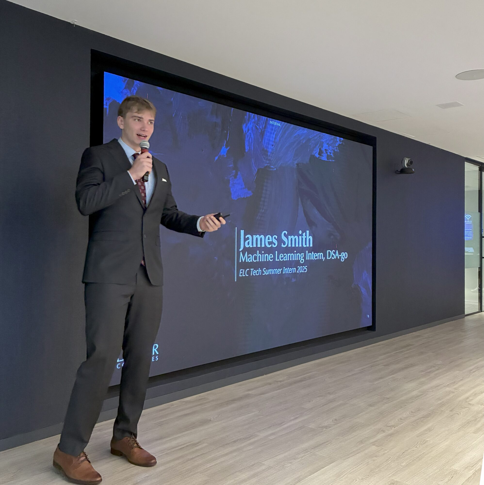
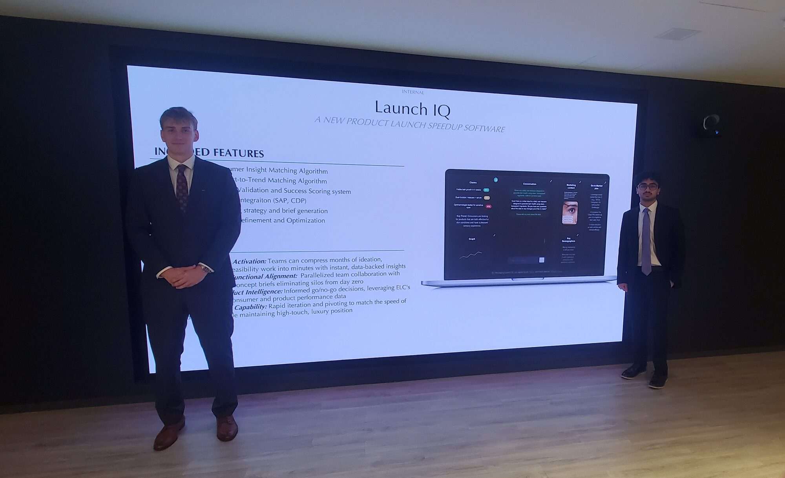
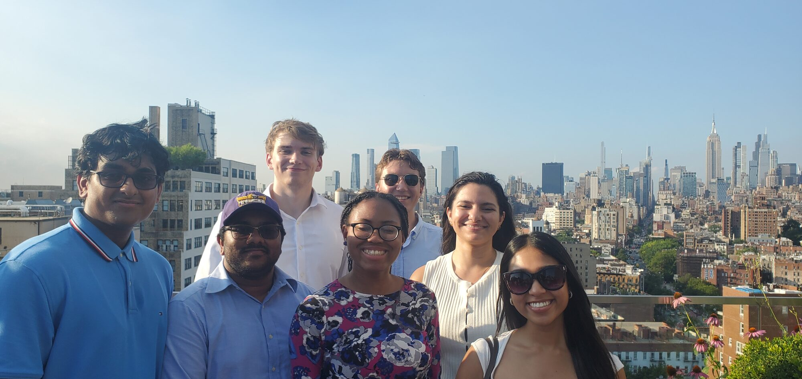
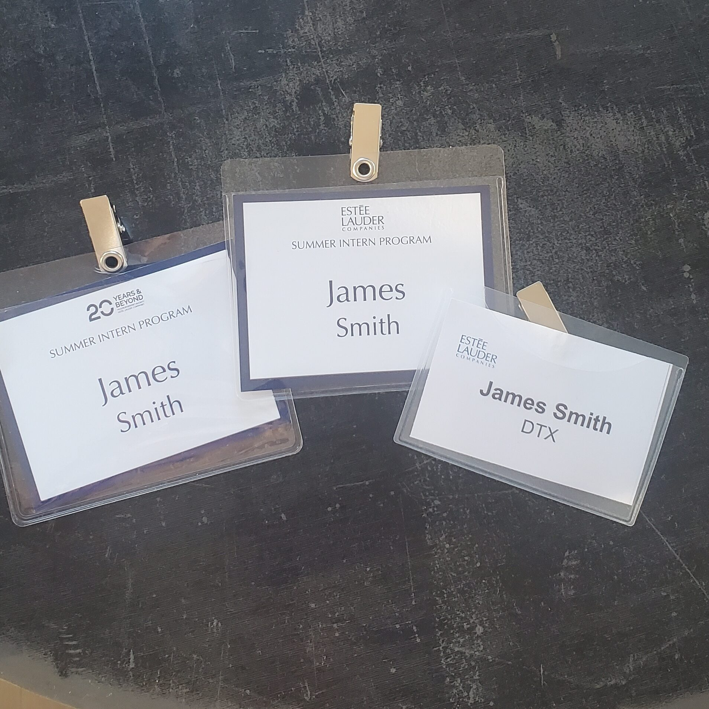
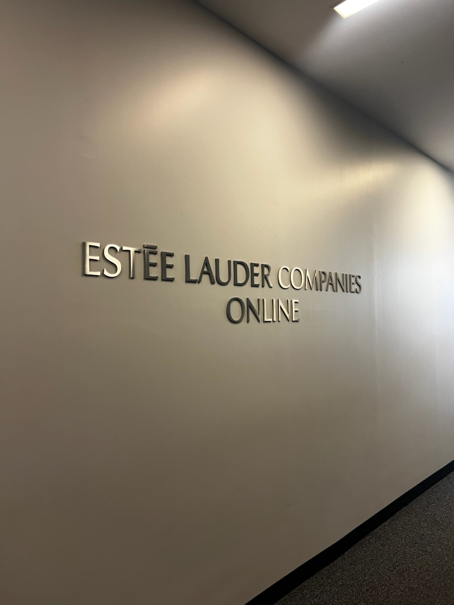

# The Estée Lauder Companies — Machine Learning Intern

## 1. Snapshot
Summer 2025 ML internship on Estée Lauder's global Data Science & Analytics team in New York. James built the data and agent layer behind a **customer-facing product-recommendation chatbot**: he unified **12,000 live SKUs from 30+ brand databases** into one searchable index, built the microservice that feeds it, and put a **vector-database cache** in front of the team's internal LLM calls. He also ran the analysis that helped stakeholders commit to retiring a legacy catalog system, and built Google ADK + MCP agent tooling, sending bug reports back to Google's ADK team.

Stack: **Python, Google Agent Development Kit (ADK), Model Context Protocol (MCP), SQLite, vector database / embeddings, pandas, microservices.**

## 2. Headline numbers
| Number | Tag | Source |
|---|---|---|
| **12,000 live SKUs** across **30+ brand databases**, **50+ features per SKU** | 🟢 | résumé |
| **$1.5M projected annual revenue** and **2% global add-to-cart uplift** for the recommendation chatbot | 🟡 | projection (résumé); say "projected" |
| **45% reduction in LLM token costs**, targeted by the vector-db cache | 🟡 | résumé says "targeting"; say "designed to cut ~45%" |
| Legacy "Broadcast" catalog ≈ **8,500 SKUs**, carrying only **8.5% of SKU volume** vs the modern "Loki" system | 🟢 | résumé |
| Presented to **VP-level stakeholders**; work slated for global rollout | 🟢 | info notes |

## 3. Accomplishments
1. **Product data unification for the recommendation engine.** *Context:* product data lived in 30+ brand databases with inconsistent schemas, so a chatbot couldn't answer specific questions. *Action:* normalized 12,000 SKUs × 50+ features into a centralized **SQLite reverse-search index**, and built and deployed a **microservice** that pulls and normalizes data from all 30+ sources. *Result:* the chatbot could answer hyper-specific queries such as "eczema-safe products, no parabens, sustainably sourced".
2. **Agentic recommendation workflow.** Built the agentic AI workflow behind the customer-facing recommendation chatbot, which is projected at **$1.5M in revenue** and a **2% global add-to-cart uplift**.
3. **LLM cost control.** Designed a **vector-database caching layer** over all internal AI calls (the chatbot and internal coding assistants). It reuses existing embeddings instead of regenerating them and targets a **~45% cut in token spend**.
4. **Catalog migration analysis.** Led exploratory data analysis comparing the legacy Broadcast system (~8,500 SKUs) with the modern Loki system. It showed Broadcast carried only **8.5% of SKU volume**, and his materials helped stakeholders commit to modernization.
5. **ADK + MCP agent tooling.** Built agent tooling with **Google ADK** and **MCP servers** for catalog queries and cross-system analysis. He filed bug reports and technical feedback to Google's ADK team, which influenced his team's adoption of the toolchain.
6. **Handoff.** Wrote documentation, tooling and architecture diagrams so the work could be supported after the internship ended.

## 4. Resume-ready bullets
- Developed an agentic AI workflow powering a customer-facing product-recommendation chatbot projected to generate **$1.5M in revenue** and a **2% global add-to-cart uplift**.
- Unified **12,000 live SKUs** across **30+ brand databases** (50+ features each) into a centralized SQLite reverse-search index, and deployed the microservice that feeds it.
- Designed a vector-database caching layer over all internal LLM calls, targeting a **45% reduction in token costs** by reusing embeddings.
- Led EDA for a legacy-to-modern catalog migration, showing the legacy system carried only 8.5% of SKU volume and helping stakeholders commit to modernization.
- Built Google ADK + MCP agent tooling and filed bug reports to Google's ADK team that influenced toolchain adoption.

**Short:** ML intern at Estée Lauder: 12K-SKU recommendation engine ($1.5M projected), LLM cache targeting 45% cost savings.

## 5. Keywords
Agentic AI, LLM orchestration, recommendation systems, Google ADK, MCP, vector database, embeddings, semantic caching, SQLite, search index, data normalization, microservices, ETL, pandas, EDA, stakeholder presentation, enterprise retail, e-commerce.

## 6. Soundbites
- "The model wasn't the hard part. Twelve thousand SKUs in thirty databases that all disagreed about what a 'product' was — that was the hard part."
- "Caching embeddings is the cheapest model upgrade there is: you stop paying twice for the same answer."

## 7. Artifacts & photos
Code and internal docs are proprietary; nothing is public.

| | |
|---|---|
|  |  |
|  |  |
|  |  |

Logo: `assets/logo.png`
