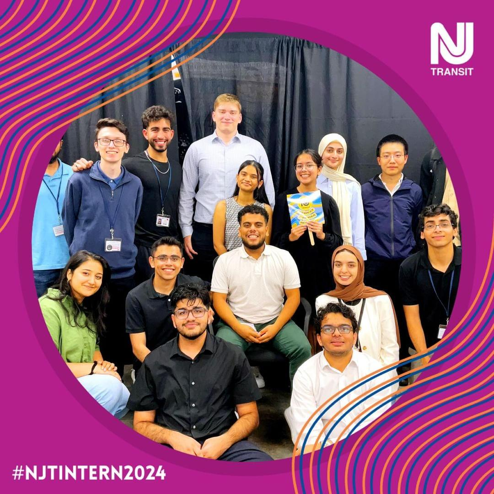
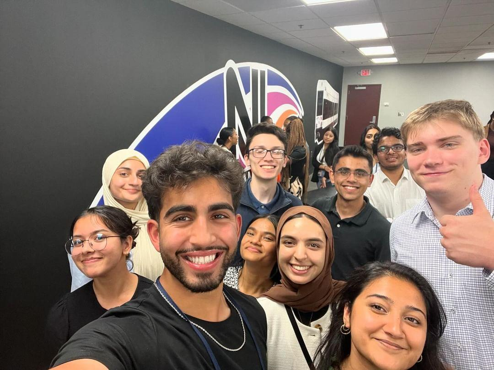

# NJ Transit — Programmer & Technical Analyst Intern

## 1. Snapshot
Summer 2024 on NJ Transit's engineering and innovations team. James hardened a **statewide digital incident-reporting system** with a large test suite and wired it into CI. He also automated an audit of the agency's **127 legacy .NET projects (2010–2023)** and found and fixed security issues in how employee data was handled.

Stack: **Jest, Gherkin/Cucumber, Azure Pipelines, Python, pandas, .NET.**

## 2. Headline numbers
| Number | Tag | Source |
|---|---|---|
| **200+ tests** across **18 suites** | 🟢 | résumé |
| **85% code coverage** on the incident-reporting system | 🟢 | résumé |
| **127 .NET projects** (2010–2023) screened and documented | 🟢 | résumé |
| Security vulnerabilities in employee-facing endpoints found and fixed | 🟢 | résumé (count not recorded ❓) |

## 3. Accomplishments
1. **Test coverage on a critical system.** Wrote 200+ Jest and Gherkin tests across 18 suites for the statewide digital incident-reporting system, bringing it to **85% coverage**.
2. **CI/CD.** Set up **Azure Pipelines** with the tests built in, so every change gets instant feedback and regressions are caught before production.
3. **Legacy portfolio audit.** Automated the screening of **127 .NET projects** with Python and pandas. Each project got documentation of its APIs, databases, libraries, plugins, errors and security posture, saving days of manual review.
4. **Security fixes.** Found and fixed vulnerabilities in how employee data was handled.

## 4. Resume-ready bullets
- Achieved **85% code coverage** on a statewide incident-reporting system by authoring **200+ tests across 18 suites** (Jest, Gherkin).
- Deployed Azure Pipelines CI/CD with integrated automated testing, giving instant feedback on every change.
- Automated the audit of **127 legacy .NET projects** with Python and pandas, documenting APIs, databases, dependencies, errors and security posture.
- Discovered and fixed security vulnerabilities in employee-data handling.

**Short:** NJ Transit intern: 200+ tests and 85% coverage on a statewide system, plus an automated audit of 127 .NET projects.

## 5. Keywords
Test automation, Jest, Gherkin, Cucumber, BDD, code coverage, CI/CD, Azure Pipelines, Azure DevOps, Python, pandas, .NET, legacy modernization, security vulnerabilities, public sector, transit.

## 6. Soundbites
- "You don't modernize 127 projects by reading them one at a time. I wrote the thing that read them for me."

## 7. Photos
| | |
|---|---|
|  |  |
|  | |

Logo: `assets/logo.jpeg`
