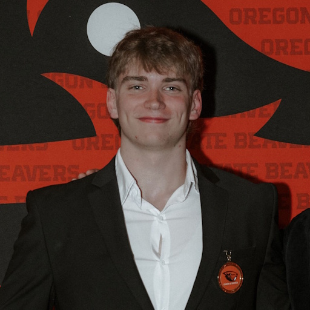

# James M. Smith

## Bio
James is an **AI/Product Engineer at Magical** in San Francisco, with about four years of experience building production AI systems, full-stack apps and automation pipelines. He has:
- worked on an Estée Lauder recommendation chatbot projected at **$1.5M** in annual revenue;
- built and secured a production AI quoting agent as an independent consultant;
- co-founded **Envolvly**, which won Oregon State's school-wide pitch competition;
- led engineering on **OpenBeavs**, Oregon State's AI-agent platform.

He graduated from **Oregon State University** in June 2026 (B.S. Computer Science, Cybersecurity minor, Cum Laude) after four years as an **NCAA Division I cheerleader**.

**Voice:** casual and conversational. He likes building things that are actually useful, talking through ideas, and finding the elegant fix to a gnarly problem.

## Contact
- Email: **real.jamesmsmith@gmail.com**
- Portfolio: https://j-m-s.dev
- GitHub: https://github.com/gitJamoo
- LinkedIn: https://www.linkedin.com/in/james-m-smith1

## Skills (summary)
- **Languages:** Python, TypeScript/JavaScript, SQL (SQL Server, PostgreSQL, SQLite), C, C++, C#, x86 Assembly, Bash
- **AI/ML:** Claude, OpenAI, Gemini, OpenRouter, Google ADK, A2A, MCP, LangChain, RAG, vector DBs, LoRA, Nemotron, YOLOv8, ByteTrack, MediaPipe
- **Web:** Next.js, React, Node.js, Express, FastAPI, Supabase, MongoDB, Auth0, Stripe Connect, Tailwind, React Three Fiber
- **Infra:** Vercel, GCP, AWS, Azure Pipelines, GitHub Actions, Jenkins, Docker, N8N, Cloudflare Tunnel, Linux
- **Security:** Kali, nmap, Wireshark, FTK Imager, Autopsy, registry and NTFS forensics

## Fun facts
- D1 cheerleader who based and stunted at Reser Stadium and March Madness.
- Founded his high school's gaming club.
- Makes short cinematic recap videos of chapters of his life (see [creative works](../project/creative-works/brag.md)).
- Won a school-wide pitch competition against non-CS students.

## Headshots & site media
| | | |
| --- | --- | --- |
|  |  |  |

- Link-preview image: `assets/og-image.png`
- Link-preview video: [assets/og-video.mp4](assets/og-video.mp4)
