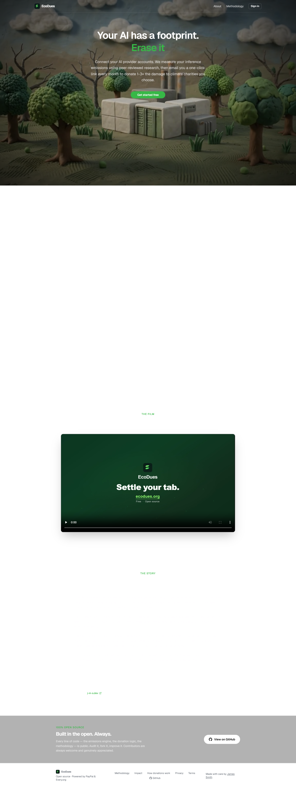
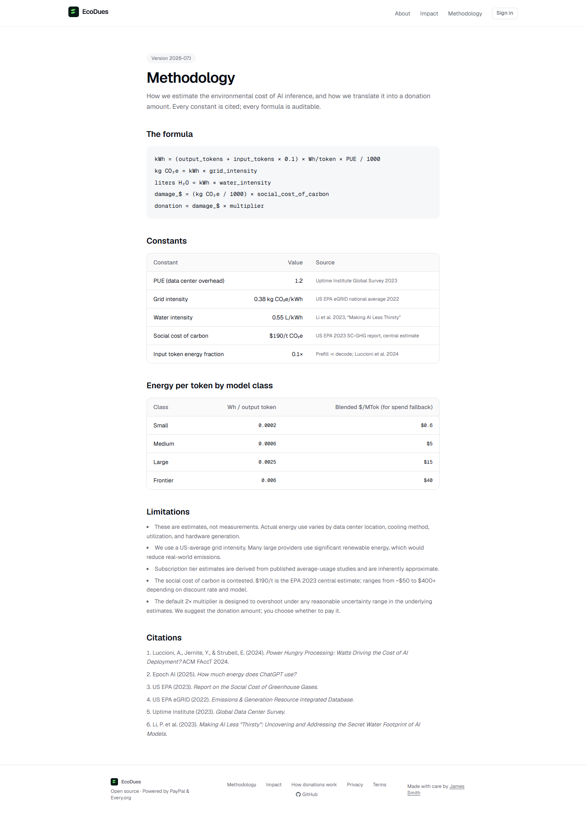
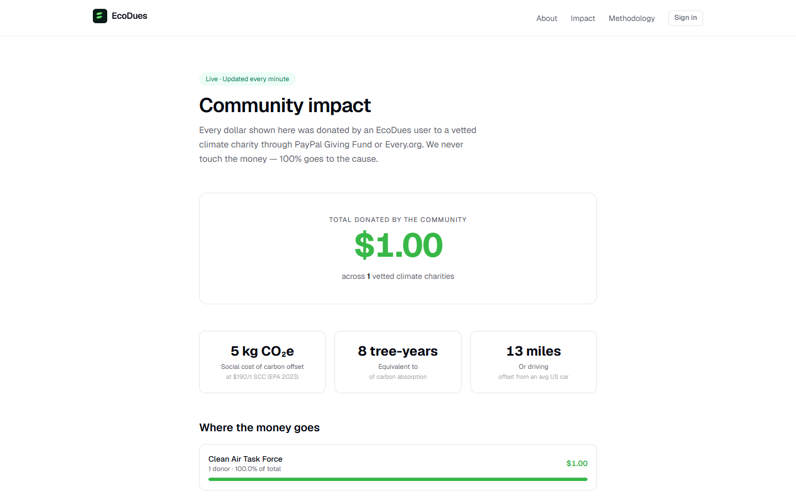
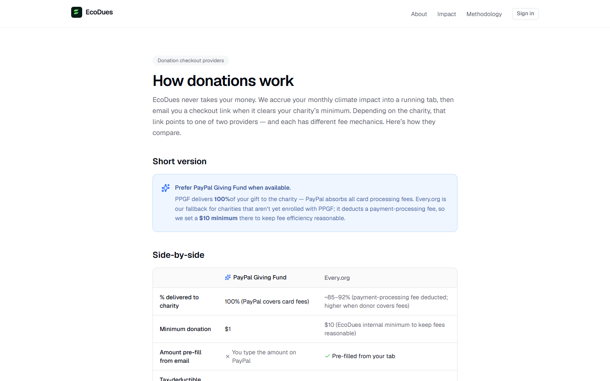
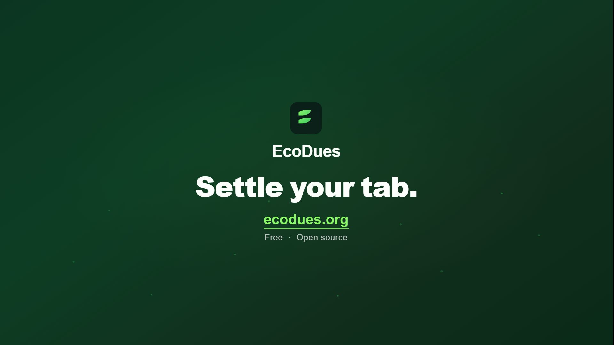

# EcoDues

## 1. Snapshot
EcoDues connects to a user's AI providers (**OpenRouter, OpenAI, Anthropic** admin keys; subscription tiers like ChatGPT Plus / Claude Pro / Copilot / Cursor; manual entry), converts monthly usage → **kWh → kg CO₂e → USD "damage"** (social cost of carbon, **published, cited methodology** at `/methodology`), multiplies it by a user-chosen factor (default **2×**, 1–3×), and emails a **one-click donation link** to a vetted climate charity via **PayPal Giving Fund / Every.org**. **It never touches the user's money** (no PCI scope, no card holding). Fully open source (MIT); emissions engine is pure, tested TypeScript.

Built **solo, end-to-end, in about 10 days**, with production database migrations, CI, SEO, legal pages, share cards, and a Remotion-produced launch film.

## 2. Headline numbers
| Number | Tag | Evidence |
|---|---|---|
| **68 commits** (67 by James + 1 Vercel bot) in **10 days** (2026-07-03 → 07-13) | ✅ | `git log` |
| **≈11,250 lines** of TS/TSX in `src/` across **108 files** | ✅ | `wc -l` on tracked src |
| **14 app routes** (dashboard, donations, leaderboard, providers, settings, onboarding, login, share, + 6 marketing/legal pages incl. methodology, impact, how-donations-work, privacy, terms) | ✅ | repo tree |
| **8 API routes** (3 cron: daily sync, monthly cycle, health-check; export CSV; share-card; Every.org webhook; unsubscribe; dev) | ✅ | repo tree |
| **16 SQL migrations** applied to production Supabase | ✅ | `supabase/migrations` (résumé said 14 → say "15+") |
| **38 unit tests** across 4 files (emissions engine, models, cycle math, unsubscribe tokens) | ✅ | grep of `it(`/`test(` — résumé said 30 |
| **CI**: TypeScript compile, ESLint, Vitest, production build on every push | ✅ | GitHub Actions workflow (commit 2026-07-05) |
| **MIT license, CONTRIBUTING.md, README** published | ✅ | repo |
| **~31–32 s** launch film (Remotion, 4 iterations v1→v4; Descript + CapCut for audio/captions; Veo drone clip) | ✅ | `marketing-video/out/`, README says 32 s |
| Users | 🟡 **3 registered as of 2026-07-07**, 100% onboarded, 0 provider-connection errors | Topic note → **don't imply traction**; lead with "shipped & live" |
| Stars/forks | 0 / 0 | ✅ `gh repo view` |

## 3. Accomplishments (exhaustive)
**Product & domain**
- Designed the **emissions methodology** (usage → energy → CO₂e → social-cost-of-carbon dollars) with cited constants in a *pure*, side-effect-free engine (`src/lib/emissions/{constants,models,engine,tiers}.ts`) so results are auditable and unit-tested; fixed a Gemini model-misclassification bug found by tests.
- Chose **Every.org / PayPal Giving Fund as the donation rail** specifically to avoid holding funds or card data (no PCI liability) — a deliberate compliance/architecture decision.
- Multiplier slider (0.25 steps) with **live donation preview**; per-provider subscription % allocation; **backfill flow** (pick plan, "using since" date, per-month spend grid); **multi-key connections** per provider with labels; per-key/plan visibility toggles.
- **Daily sync cron (03:00 UTC)** for live usage + **monthly cycle cron (1st of month)** that rolls usage into a donation "tab", accrues until the charity minimum, then sends the donation link; atomic tab-decrement migration (0015) to prevent double-spend races.
- **Dashboard:** live-computed stat cards, usage-by-source rows with per-row damage/donation, editable plans (pencil → modal), history tab, "real-world equivalents" popovers (miles driven, tree-days, phone charges, laptop hours), next-sync countdown, streaks/badges, **opt-in leaderboard**, **CSV export** (usage, estimates, ledger, payments), shareable **impact card** (avatar + OG image + download + "Post on X").
- **Public impact page** with live donation totals; **llms.txt / agents.txt / JSON-LD** for AI-search discoverability.

**Security & reliability**
- Provider API keys **encrypted at rest** (`ENCRYPTION_KEY`, 32-byte); signed unsubscribe tokens; `CRON_SECRET` bearer on cron routes; **Every.org webhook hardened**; 72-char password cap; per-action **rate limiting (10–30/min)**; `handle_new_user()` trigger locked down (EXECUTE revoked from public/anon/authenticated); **Zod validation on client + server**; generic user-facing errors + structured logger; GitHub & **Google OAuth**; connector failures logged instead of silently flagging connections; account deletion + email unsubscribe + notification prefs; privacy policy & ToS.

**Front end / UX**
- Next.js 16 App Router, Tailwind v4, Supabase auth/Postgres, Resend transactional email, Vercel hosting + crons; dark mode; mobile pass (icons-only top nav, stacked tables/cards, **eliminated mobile horizontal scroll**); branded 404/error pages; dynamic **OG images** (`opengraph-image.tsx`), `robots.ts`/`sitemap.ts`, canonical domain cleanup.
- **Marketing:** scroll-driven landing page with embedded launch film; **31-second launch film** produced in Remotion (macro headline zoom, donate-button roller, forest transition, SFX) with a Veo-generated forest clip.

**Ops**
- Namecheap → Vercel DNS (A `@` → 76.76.21.21, `www` CNAME), SSL auto; Supabase MCP-applied migrations; `/ecodues-stats` Claude skill pulling live prod metrics (signups, onboarding funnel, provider health, usage totals, charity breakdown); **post-audit TODO** pass.

## 4. Resume-ready bullets
- Founded and shipped **EcoDues** (ecodues.org, MIT open source): a Next.js/Supabase/Vercel SaaS that converts AI token usage across Anthropic, OpenAI, and OpenRouter into CO₂e and social-cost-of-carbon dollars, then generates proportionate monthly charity donation links via Every.org — built solo in ~10 days (68 commits).
- Engineered a **pure, fully tested emissions engine** (38 Vitest tests) and a **daily-sync + monthly-cycle cron architecture** with atomic ledger updates, encrypted provider keys, webhook hardening, rate limiting, and 16 production migrations.
- Chose a **no-custody donation architecture** (Every.org / PayPal Giving Fund) to eliminate PCI scope; implemented GitHub + Google OAuth, Zod-validated inputs, locked-down DB triggers, and CI (tsc, lint, Vitest, build).
- Shipped the full product surface — dashboard, backfill flows, multi-key connections, CSV export, opt-in leaderboard with streaks/badges, shareable impact cards, SEO/OG, AI-search (`llms.txt`) — plus a Remotion-produced launch film.

**Short:** Solo-built and launched EcoDues, an open-source carbon-offset SaaS for AI usage (Next.js, Supabase, Vercel, Every.org) — 38 tests, CI, 16 migrations, ~10-day build.

## 5. Keywords
Next.js 16, React, TypeScript, Tailwind CSS v4, Supabase (Postgres, Auth, RLS-style hardening), Vercel (crons, Edge OG images), Zod, Vitest, GitHub Actions, OAuth (GitHub/Google), Resend, Every.org Partner API, PayPal Giving Fund, cron jobs, webhooks, rate limiting, encryption at rest, CSV export, SEO, structured data (JSON-LD), llms.txt, Remotion, Descript, open source (MIT), sustainability/climate-tech, FinOps-adjacent (token usage accounting).

## 6. Soundbites
- **Why build it?** "AI has a real energy footprint. I wanted a one-click way to offset *my own* inference usage at twice its calculated damage — and I wanted the math public, so I open-sourced the engine and published the methodology."
- **Design decision:** "I didn't want to hold anyone's money — Every.org is the rail, we just send a pre-filled link. That removed PCI and custody from scope entirely."
- **Speed:** "Ten days from first commit to live, with CI and 16 migrations — mostly by keeping the engine pure and test-first and by leaning on Claude Code for scaffolding."
- **Debugging stories (confirm details before telling):** migration 0015 made the donation-tab decrement atomic (confirm what failure it prevented); inline-SVG id collisions made the logo vanish in the dashboard sidebar; stray OAuth codes landing on `/` needed forwarding to `/auth/callback`; video-scrub progress math broke for zones shorter than the viewport.

## 7. Artifacts & screenshots
- Live: https://ecodues.org · methodology: /methodology · launch film: /launch-film.mp4 (local: `countervail/public/launch-film.mp4`; poster in assets)
- Repo local: `Documents/Github-Projects/countervail/` (CLAUDE.md has architecture notes; `docs/superpowers/` design docs)

| | |
|---|---|
|  |  |
|  |  |
|  |  |
