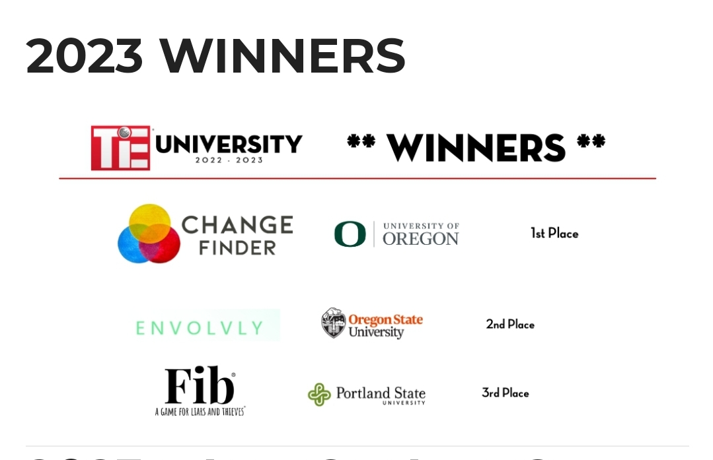
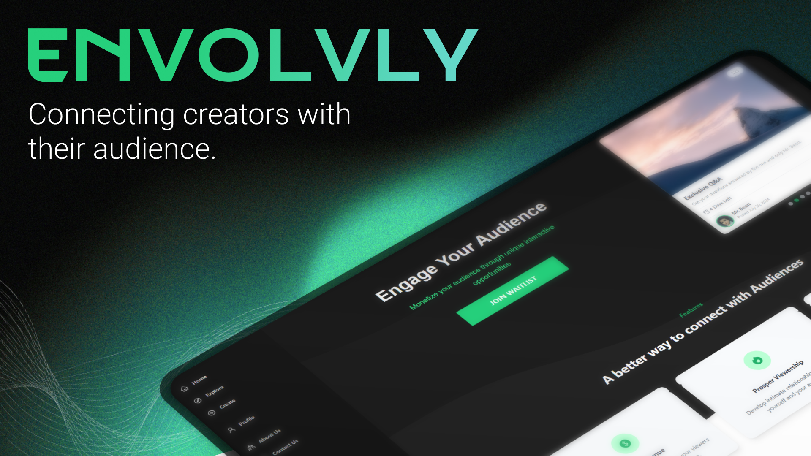

# Envolvly

## 1. Snapshot
Envolvly is a **B2B SaaS marketplace for creators** ("a platform for creators", per envolvly.com). James co-founded it at Oregon State and is its **technical co-founder and lead engineer**. He built the full **MERN** application (MongoDB, Express, React, Node.js) from scratch on AWS, set up CI/CD, added **Auth0** authentication and **Stripe Connect** payments and payouts, and grew it to **1,000+ users**. Envolvly **won Oregon State's school-wide startup pitch competition**.

Stack: **React, TypeScript, Node.js, Express, MongoDB, Auth0, Stripe Connect, AWS, Docker, GitHub Actions, N8N** (a private `Envolvly-Micro-N8N` automation repo).

## 2. Headline numbers
| Number | Source |
| --- | --- |
| **1,000+ users** | résumé (no analytics export checked) |
| **Won** OSU's school-wide startup pitch competition | résumé, plus a photo |

## 3. Accomplishments
1. **Full-stack build.** Led development end to end on the MERN app, from concept to a platform with active users. He was the primary engineer throughout.
2. **Auth.** Integrated **Auth0**, with client-credentials backend flows, JWT expiry handling and refresh-token management.
3. **Payments.** Integrated **Stripe Connect** for the full money flow, from customer payments through creator payouts.
4. **Infra and process.** AWS hosting, Docker, a GitHub Actions CI/CD pipeline, and Agile sprints with feature branches and PR review.
5. **Pitch win.** Pitched Envolvly against non-CS teams and won OSU's school-wide startup pitch competition.

## 4. Resume-ready bullets
- Co-founded a B2B SaaS creator marketplace and led end-to-end development of the full-stack MERN application, growing it to **1,000+ users**.
- Implemented secure authentication with Auth0 (client-credentials backend flows, JWT expiry handling, refresh tokens).
- Integrated Stripe Connect for a complete payments and payouts system, from customer payments to creator disbursements.
- Won Oregon State University's school-wide startup pitch competition.

**Short:** Co-founded Envolvly, a creator-marketplace SaaS (MERN, Auth0, Stripe Connect, 1,000+ users); won OSU's pitch competition.

## 5. Keywords
Startup, co-founder, B2B SaaS, marketplace, creator economy, MERN, MongoDB, Express, React, Node.js, TypeScript, Auth0, JWT, OAuth, Stripe Connect, payments, payouts, AWS, Docker, CI/CD, GitHub Actions, N8N, Agile, pitching, entrepreneurship.

## 6. Soundbites
- "Payments was the part that made it a real business. Stripe Connect means the money goes from customer to creator without us ever holding it."
- "I won the pitch against business majors by showing the product working, not slides about it."

## 7. Artifacts & photos
- Live: https://www.envolvly.com
- 
- 
- Logo: `assets/logo.png`
