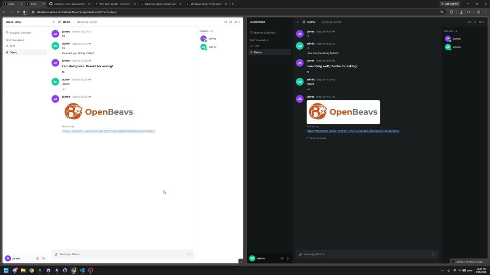
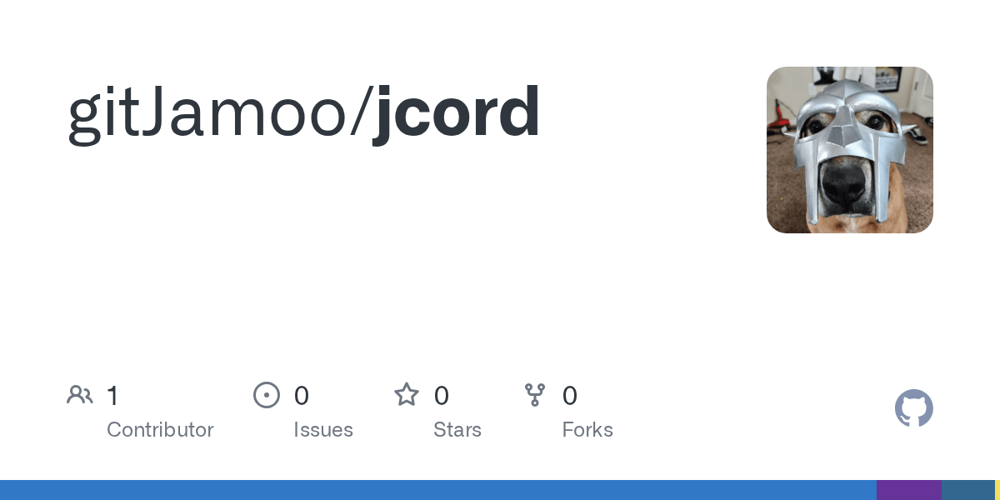

# jcord

<!-- hero -->

*jcord: real-time chat with voice and video, built in about a day.*

## 1. Snapshot
A **real-time chat, voice and video app**, built solo as a **take-home challenge** in about a day. The spec asked for four things: rooms, real-time messages, an active-user list and accounts. jcord does all four and then adds most of the optional bonus features:
- **voice and video** over WebRTC with LiveKit, in a Discord-style grid;
- persistent message history;
- `Ctrl+F` message search;
- typing indicators;
- unread badges and read receipts.

Stack: **Next.js 16, TypeScript, Supabase (Realtime, Auth, PostgreSQL), LiveKit (WebRTC), Tailwind CSS v4, shadcn/ui, Vercel.**

## 2. Headline numbers
| Number |
| --- |
| Built in **~1 day** (repo created 2026-03-20; commits dated 2026-03-19) — git / GitHub API |
| ≈**3,100 lines** of TS/TSX — `wc -l` |
| **4/4** core requirements plus **6** bonus features — README |
| Live demo and demo video |

## 3. Accomplishments
1. **Real-time messaging.** Supabase Realtime (Postgres logical replication over WebSockets) per room, with optimistic UI.
2. **Voice and video.** A LiveKit WebRTC integration with a custom Discord-style grid, avatars when cameras are off, and mic and camera controls.
3. **Presence and typing.** Supabase Presence shows who's online in each room. "X is typing…" indicators cancel themselves after 2 seconds of inactivity.
4. **Persistence and search.** Every message is stored in PostgreSQL and searchable with `Ctrl+F`/`Cmd+F`.
5. **Unread tracking.** Unread badges and read receipts in the sidebar.
6. **Auth.** Separate accounts with username and password through Supabase Auth.

## 4. Resume-ready bullets
- Built jcord, a Discord-style real-time chat app with WebRTC voice and video (Next.js 16, Supabase Realtime, LiveKit) in about a day, beating a take-home spec with 6 bonus features.
- Implemented presence, typing indicators, unread badges and read receipts, and full-text message search over persisted PostgreSQL history.

**Short:** jcord: real-time chat with voice and video (Next.js, Supabase, LiveKit), built in a day.

## 5. Keywords
Real-time systems, WebSockets, WebRTC, LiveKit, Supabase Realtime, Supabase Auth, PostgreSQL, presence, optimistic UI, Next.js 16, TypeScript, Tailwind CSS v4, shadcn/ui, Vercel, take-home.

## 6. Artifacts
- Repo: https://github.com/gitJamoo/jcord
- Live: https://takehome-james-michael-smith.vercel.app/
- Demo video: https://youtu.be/jhuBei7J2RM, thumbnail: 
- 
