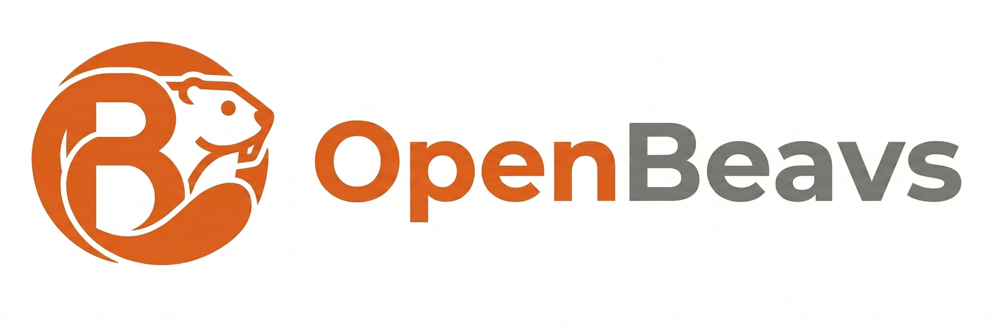
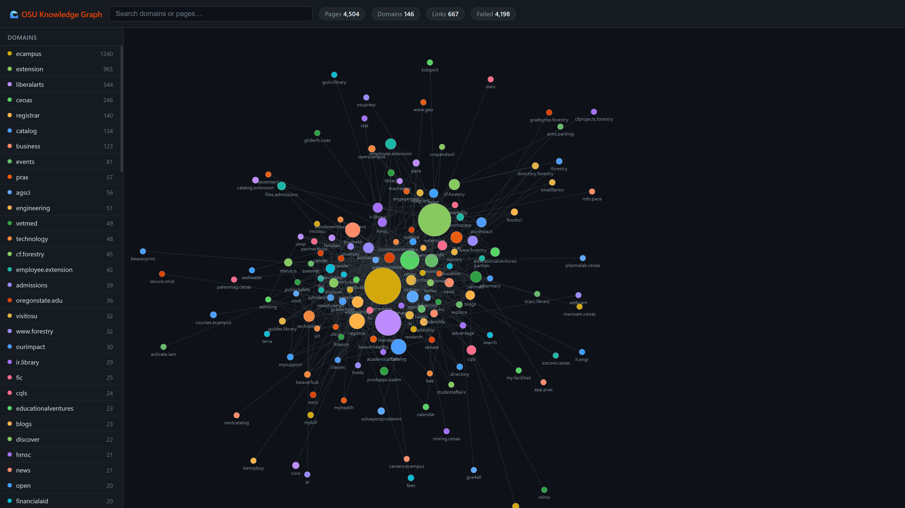

# OpenBeavs — AI Agent Platform for OSU

## 1. Snapshot
A **single, OSU-authenticated hub** where students and faculty discover, install, and chat with specialized AI agents — built on an open protocol (**Google A2A**, JSON-RPC 2.0, `/.well-known/agent.json` agent cards) so any team can register an agent in any language. Sign-in is **Microsoft SSO** (no new accounts). Shipped as the **OSU CS 46X senior capstone** (9 months, project sponsored by a professional/faculty advisor) and **went live**; the next capstone group (OpenBeavsV2, Oct 2026) continues it.

Stack: **SvelteKit** (forked **Open WebUI v0.6.5**) + **FastAPI/Python**, **GCP Cloud Run** (us-west1), **Docker**, **GitHub Actions** (ruff, ESLint, pytest gates), **Microsoft Entra ID SSO**, A2A protocol, **Firestore vector search + Gemini embeddings (`gemini-embedding-001`, 768-d)** for RAG, D3 knowledge-graph viz.

## 2. Headline numbers (recomputed from GitHub on 2026-10-20)
| Metric | Value | Tag | Note |
|---|---|---|---|
| Commits in core repo | **134 of 234 (57%)** incl. merges · **122 of 178 (69%)** non-merge | ✅ | James appears under 3 identities (`James`, `James Smith <[email]>`, GitHub noreply) |
| Merged PRs in core repo | **28 of 49** authored by gitJamoo | ✅ | résumé said "9" — understates |
| Repos sole-authored | **OSU-RAG-Pipeline** (37 non-merge commits, 100%), **example_a2a_agents** (12/12, 100%), **Microsoft-SSO-Test-App** (archived) | ✅ | |
| Lines added | **≈28.8k excl. lockfiles** (core 14.7k + RAG 7.3k + example agents 6.8k); ≈45.8k incl. lockfiles; ≈2.2k deleted core | ✅ | résumé's "49,000+" not reproducible → use "~29K" |
| Active window | 2025-10-03 → 2026-05-28 (James's first→last commit in core repo) | ✅ | |
| Contributors (core repo, GitHub API) | gitJamoo (James) 108, the most of 5 contributors (API counts differ from `git log` because of identities/merge handling) | ✅ | |
| Production bugs fixed | "9+" (startup crashes → 500s on live endpoints) | 🟡 | no countable artifact |
| Live | **genesis.dev.oregonstate.edu** (per the CS 043 expo poster) ✅; also a Cloud Run deployment `openbeavs-deploy-test-…us-west1.run.app` linked from your site | ✅ | access requires an OSU account (Microsoft SSO + Duo MFA) |

## 3. What James personally built / owned
1. **A2A-compliant agent registry & routing** (FastAPI + SvelteKit): agent-card discovery, JSON-RPC cross-agent routing, admin management, visibility controls.
2. **OSU RAG Pipeline (sole author)** — multi-threaded **BFS web crawler** (rate limiting, **circuit breaker**, retry/backoff, robots.txt compliance, URL exclusion lists) continuously indexing `*.oregonstate.edu`; **ETL pipeline** (LangChain text splitting → Gemini embeddings → **Firestore vector search**, SHA-256 content-hash dedup so unchanged pages are skipped, stale-vector cleanup, cron-ready every ~6 h); **D3 knowledge-graph visualization** ("interactive RAG view"); `osu_rag_agent` + A2A server + `odk_dashboard`; Cloud Run deploy script; embeddable via one line of code. 37 commits, 2026-02-17 → 05-09, ≈7.3K lines added.
3. **Example A2A agent library (sole author)** — 5 new agents + migrated ones (e.g., weather, writing coach, OSU knowledge) proving "build an agent in minutes" claim; ≈6.8K lines.
4. **Microsoft SSO integration** — standalone test app (Entra ID multi-tenant app registration, delegated Graph scopes `User.Read/email/openid/profile/offline_access`, token inspection) that de-risked the "no new accounts" requirement, then integrated into the hub.
5. **Zero-manual-step GCP Cloud Run deployment** (`Dockerfile`, `cloudbuild.yaml`, `deploy.sh`, Makefile) and **CI** (GitHub Actions: ruff + ESLint + pytest; kept green).
6. **Platform glue:** ticket-submission modal, Chris chat component/tests (tone-analysis agent integration), agents workspace UI (`Agents.svelte`), database access guide, partner handoff (`PARTNER_HANDOFF.md`), CLAUDE.md/AGENTS.md for AI-assisted dev, CONTRIBUTING/SECURITY/CHANGELOG docs.
7. **Secure A2A trust-plane collaboration** with advisor (Cyrano-de-Bergerac-A2A-Secure: TLS + agent registry for service identity) — James contributed integration (1 commit); advisor-led.
8. **Team/leadership:** largest contributor; reviewed/merged PRs; handed off to the next cohort (V2 team's first commits Oct 2026).

## 4. Resume-ready bullets
**Defensible (use these):**
- Led engineering on OpenBeavs, Oregon State's AI-agent platform (senior capstone, 4-person team): **134 of 234 commits (57%)** and **28 of 49 merged PRs** in the core repo; sole author of the OSU RAG pipeline and A2A agent library (~29K lines added across 3 repos).
- Architected a Google **A2A-compliant agent registry** (FastAPI + SvelteKit) with agent-card discovery, JSON-RPC cross-agent routing, admin controls, and visibility scopes; integrated **Microsoft SSO** so students/faculty need no new accounts.
- Built the **OSU RAG Pipeline**: multi-threaded BFS crawler with rate limiting and circuit breaker, ETL, and a D3 knowledge-graph visualization that indexes `*.oregonstate.edu` to power a student-facing, one-line-embeddable AI knowledge agent.
- Automated GCP Cloud Run deployment (no manual steps) and CI/CD via GitHub Actions (ruff, ESLint, pytest gates); diagnosed and fixed production failures from startup crashes to 500s on live endpoints.

**Short:** Capstone lead: shipped OSU's A2A agent hub (SvelteKit/FastAPI/GCP, Microsoft SSO) — 57% of commits, 28 merged PRs.

**Leadership/impact angle:** Delivered a live university-wide platform that other teams can build on (open protocol, 5 example agents) and handed it to the next cohort.

## 5. Keywords
Agent2Agent (A2A), JSON-RPC 2.0, agent registry, Model Context Protocol (adjacent), RAG, vector search (Firestore), embeddings (Gemini), web crawling, content-hash deduplication, LangChain text splitters, knowledge graph, D3.js, SvelteKit, Open WebUI, FastAPI, Python, TypeScript, GCP Cloud Run, Docker, Cloud Build, GitHub Actions, pytest, ruff, ESLint, Microsoft Entra ID / Azure AD SSO, OAuth2/OIDC, Microsoft Graph, API design, system design, technical writing.

## 6. Soundbites
- **Pitch:** "OSU students use dozens of AI tools and none of them know anything about OSU. OpenBeavs is one login, one registry, and an open protocol so any team can plug an agent in."
- **Hardest bug:** startup crashes on Cloud Run and 500s on live endpoints — diagnosed from logs/Cloud Run revisions; led to the zero-touch deploy pipeline.
- **Ownership:** "I wrote the crawler and RAG agent end-to-end — rate limiting and a circuit breaker so we didn't hammer oregonstate.edu, then a D3 graph so people could *see* retrieval."
- **Team:** 4 students, 9 months, external sponsor; I was the largest contributor and wrote the deployment/CI so the others could ship safely.

## 6b. Sponsor, scope and security (from the capstone documents — ✅)
- **Sponsor:** a director of AI strategy in OSU's Division of Research & Innovation (faculty/client advisor). Team: James + 3 CS/AI teammates.
- **Origin:** the capstone concept doc (v2025-09-25) defined a portal for faculty-facing agents — **FAIE** (Faculty Advisor for Industry Engagement), **AMIE** (Academic Manuscript IP Evaluator), **GOA** (Grant Opportunity Analyzer) — with a registry, persistent chats, document upload, SSO. James and the sponsor were *already discussing the project* before the team formed: he helped define the capstone, not just take it.

## 7. Artifacts & screenshots
- Repos (org `OpenBeavs`): `OpenBeavs`, `OSU-RAG-Pipeline`, `example_a2a_agents`, `Microsoft-SSO-Test-App` (archived), `original-frontend` (archived, React), `open-webui` fork (archived), `Cyrano-de-Bergerac-A2A-Secure`.

