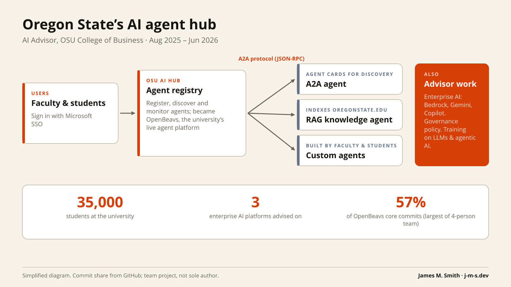
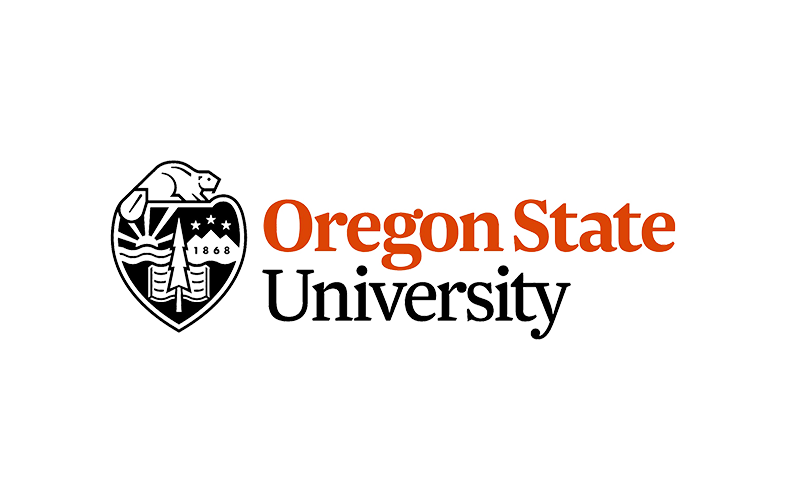

# OSU AI Hub & A2A Reference Systems

<!-- hero -->

*The OSU AI Hub and its A2A agent ecosystem.*

## Product lineage (say this in interviews to avoid "two projects?" confusion)
`OSU AI Hub` (React + FastAPI/Express registry, Aug–Dec 2025; repo `OpenBeavs/original-frontend`, archived) → forked **Open WebUI v0.6.5** (`OpenBeavs/open-webui`, archived Oct 2025) → **OpenBeavs** (SvelteKit + FastAPI, capstone, live) — one platform, three iterations.

## Components & evidence
| Artifact | What it demonstrates | Evidence |
| --- | --- | --- |
| **Cyrano de Bergerac (ADK-only)** | Google ADK `SequentialAgent` orchestrator: Chris (tone classifier → JSON) → Cyrano (wordsmith) | `Cyrano-de-Bergerac-ADK-Only` — James 10 / advisor 5 commits |
| **Cyrano de Bergerac A2A** | Same agents exposed as **A2A servers** (ports 8001/8002); Roxane root agent delegates via A2A; `main.py serve-all`; `adk run/web` | `Cyrano-de-Bergerac-A2A` — James 15 / advisor 2 |
| Cyrano variants | N8N version, A2A-Secure (TLS + registry trust plane by advisor; James 1 commit) | |
| **Agentic-coding guide** (`AI-Agents` / `Documentation-on-Agentic-Coding-Assistants`) | ~316-line guide: autonomy/context/planning/memory, use cases, benefits/challenges, qwen-code & Claude Code setup | James 3 commits Oct–Nov 2025 |
| **GitHub CI/CD demo** | Minimal Python module + `unittest` + Actions workflow explaining triggers/runners/feedback | 4 commits |
| **Typst example** | Teaching repo for the Typst typesetting language (math, scripting, layout) | 3 commits |
| **Claude Code demo** (`Vibe-code-stock-analysis`) | Stock analyzer (yfinance; RSI/MA/Bollinger/MACD; buy/sell with confidence) as an "agentic coding" showcase | 2 commits |
| **Microsoft SSO Test App** | Entra ID multi-tenant app registration, Graph delegated scopes, token explorer | 2 commits |
| **Capstone DOCX→PDF** | CLI that enforces CS46X filename convention | 6 commits |
| A2A Inspector (fork of google-a2a/a2a-inspector) | tooling used to debug agent cards (0 James commits; local fork has 58 commits from upstream) | context only |

## Bullets
- Built reference **multi-agent A2A systems** (Google ADK) — orchestrator → tone-classifier → generator — used to teach agent-to-agent communication across the university.
- Produced **teaching repos** for agentic coding (Claude Code, qwen-code), CI/CD with GitHub Actions, Typst, and Microsoft SSO — adopted as onboarding material for the College of Business team.
- Engineered the agent registry that became OpenBeavs (see project sheet).

## Keywords
A2A, Google ADK, SequentialAgent, JSON-RPC, agent cards, FastAPI, orchestration, tone classification, prompt design, GitHub Actions, unittest, Claude Code, qwen-code, Typst, Entra ID SSO.

## Artifacts

