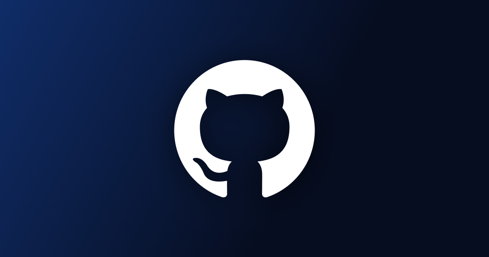

# OVERSEER

<!-- hero -->

*OVERSEER: on-device computer vision for posture and focus, shipped with a paywall in 13 days.*

## 1. Snapshot
A **commercial-style desktop app** (Tauri v2 + React/TypeScript + Rust, OpenCV-based vision) that watches you through the webcam with **low CPU overhead** to enforce **posture** (slouch >30 s), **eye/gaze focus** (looking away → full-screen "focus lock"), and **Pomodoro** work sessions — with a **focus meter**, **gaze calibration**, **onboarding wizard**, and **alert overlays**. Monetized: **Supabase Auth + Postgres RLS**, automatic **14-day free trial** via DB trigger, and **LemonSqueezy license-key** activation, with offline-tolerant license checks. A dedicated **"mysterious" dark landing page** with OS detection (Win/macOS/Linux download button) shipped Dec 24.

## 2. Headline numbers
| Number |
| --- |
| 20 commits, **Dec 20 2025 → Jan 1 2026** (13 days) from zero to paywalled app |
| ≈**3,000 lines** TS/TSX/Rust in app (`src` + `src-tauri`) |
| **14-day** trial; Pro via LemonSqueezy license — AUTH.md |

## 3. Accomplishments
- Vision pipeline (`services/vision.ts`, gaze calibration, camera preview, alert overlay), focus meter, forced violation detection, Pomodoro options, eye tracking (Dec 24), debug mode.
- **Licensing/auth architecture:** Supabase email/password auth, `user_profiles` table with check constraint (`is_pro` ⇒ license key present), **RLS policies**, `handle_new_user` trigger → 14-day trial, LemonSqueezy license activation, `PaywallWrapper`, user verification (Dec 31), reworked checkout (Jan 1).
- **Go-to-market:** separate landing repo (React + vanilla CSS, premium dark theme, OS detection, pricing section), deployed on Vercel.
- Prototype lineage: `CV-Gestures` (Python OpenCV+MediaPipe monitor with posture overlay & "FOCAL LOCK").

## 4. Resume-ready bullets
- Designed, built, and shipped **OVERSEER**, a Tauri/React/Rust desktop app that uses on-device computer vision (OpenCV) to monitor posture and gaze, with focus-meter, calibration, and Pomodoro features — in 13 days.
- Implemented a full **SaaS licensing stack**: Supabase Auth, RLS-protected profile table, DB-trigger 14-day trial, LemonSqueezy license-key activation, offline-tolerant paywall; shipped a Vercel-hosted landing page with OS-aware downloads.
**Short:** Solo-shipped a privacy-first CV desktop app (Tauri/Rust/React) with trial + license paywall in under two weeks.

## 5. Keywords
Tauri 2, Rust, React, TypeScript, Vite, OpenCV, MediaPipe, gaze/head-pose estimation, desktop app, Supabase Auth/RLS/triggers, LemonSqueezy, licensing/paywall, client-side app store (`store.ts`), Vercel, product launch.

## 6. Soundbites
"Posture and eye-strain apps are either cloud cameras or nag-ware. I wanted on-device vision with a real paywall — 14-day trial in a Postgres trigger, license key through LemonSqueezy."

## 7. Artifacts & screenshots
`assets/portfolio-thumbnail.png` · landing site: overseer-website.vercel.app (capture screenshots; not rendered here) · repos above.
