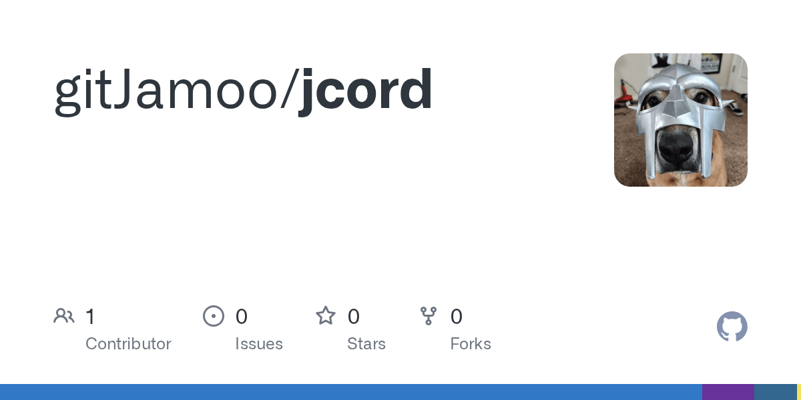

# Smaller Tools & Sites (evidence for breadth; use sparingly)

<!-- hero -->

*Smaller tools, sites and automations James has shipped.*

| Project | What | Evidence |
| --- | --- | --- |
| **Hermes** (in progress) | Personal multi-agent AI coordinator on self-hosted hardware (Raspberry Pi 5 + Dell OptiPlex). Telegram interface with a human-approval gate for outbound actions, MCP integrations for Gmail and Calendar, a shared state layer. Security-first: hardcoded sender allowlists, an agent-owned email identity, and approvals routed outside email to block command injection | |
| **Personal homelab** | Pi 5 + OptiPlex running Docker services behind Caddy (`.home` subdomains), Pi-hole DNS, a Tailscale mesh for SSH from anywhere, Uptime Kuma monitoring and auto-restart. Hosts n8n, Plane, a Minecraft server and the Hermes agents | |
| **n8n automation suite** | Self-hosted n8n (Docker, Cloudflare Tunnel): AI sentiment analysis feeding automated newsletters, social listening, lead generation and enrichment, self-healing infrastructure alerts | |
| **mdsnip** | Single-file Python CLI that lets AI agents read and edit one markdown section at a time with few tokens, using stable HTML-comment anchors and heading-path queries | |
| **iStunt Website** | Next.js 14 + Tailwind + shadcn/ui site for an Albany, OR cheer-training gym: class schedule, programs, contact form via **Resend with rate limiting**, iClassPro enrollment links; 27 commits in 2 days (Mar 15–16, 2026) | repo |
| **ESP32 Hermes Agents Hub / Claude-usage TFT display** | ESP32 + TFT: shows Claude API / Claude.ai Pro usage via OAuth rate-limit headers + 5-hour session tracking (May 21), then **Hermes Agents Hub** polling agents directly (Jun 1); **CS 043 OpenBeavs expo display** | 8 commits |
| **Carrick certificate automation / sentiment brief / Invest Carrick** | see [Carrick FC sheet](https://github.com/gitJamoo/brag-sheets/blob/main/experience/carrick-fc/brag.md) | |
| **JMStudio brand site** + business cards + network graph | 7 commits Apr 20, 2026 | |
| **ResumAI** | Python resume analyzer + LaTeX cover-letter generator (job → company address search → 3 personalized paragraphs → compile-ready LaTeX), prompts in repo; likely the source of the 20 `Cover_Letter*.pdf` files from Oct 2025.  | 5 commits |
| **Capstone DOCX→PDF** | submission-naming CLI | |
| **Discord bots** (`Personal-Pi-Discord-Bot`, COORDINATOR bot) | Pi-hosted bot boilerplate; RAG Q&A bot | |
| **CV experiments** | `CV-Gestures` (posture/focus monitor), `Face-Bounding-Box-Video`, `Screen-Reader-Near-Webcam`, Python teleprompter | |
| **Mi-Fit/Zepp workout exporter** (upstream fork; no James commits) | used with the `amazfit-health-report` skill for personal health analytics | context only |
| **Rustmon** (Rust Pokémon, Jan 2024, 8 commits), `fastAPIPokemon`, `minesweeper`, `py-typing` | learning projects | |
| **js-cli-portfolio / portfolio / gitJamooDevBlog / AstroBlog / jamesPortfolio** | earlier portfolio generations 2022–2024 (CLI-style JS portfolio Jul–Aug 2024; Astro blog 2022) | |
| **Oregon State University Mapping** (Jan 2024, 9 commits), **OSUPWL-Website** (OSU Powerlifting club site, May 2023), **Howmanyplates** (Mar 2023) | club/utility sites | |
| **RedditVideoMakerBot** (fork, 865 commits upstream; 2022) | open-source tool explored | context only |
| **Xenopixel V2 profiles** (Aug 2022, 16 commits) | hobby project (purpose unconfirmed) | |

**Soundbite:** "I build things for the teams around me — a gym site, a certificate generator for a football club, a TFT display for the capstone expo."

