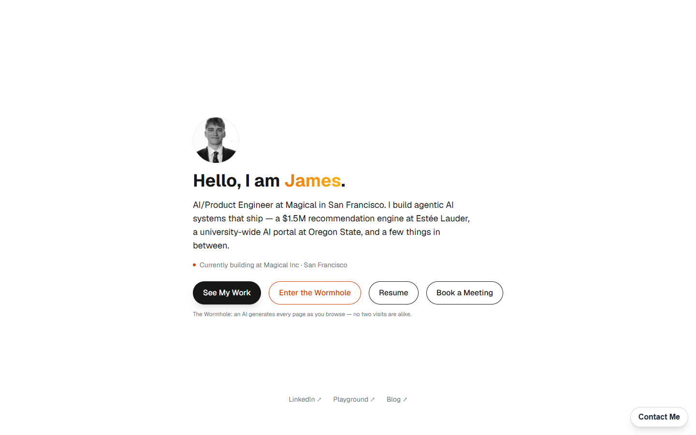
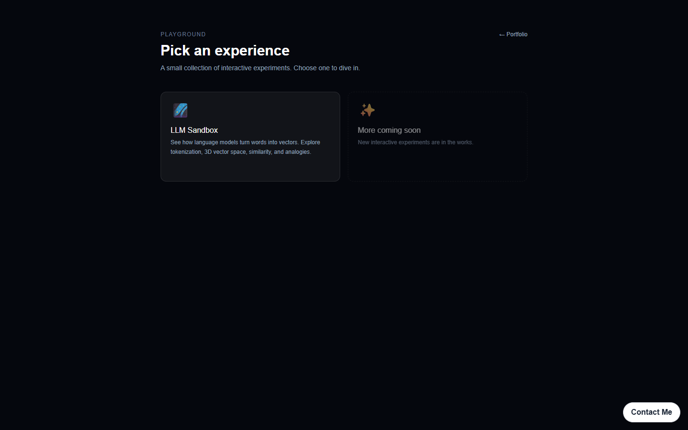
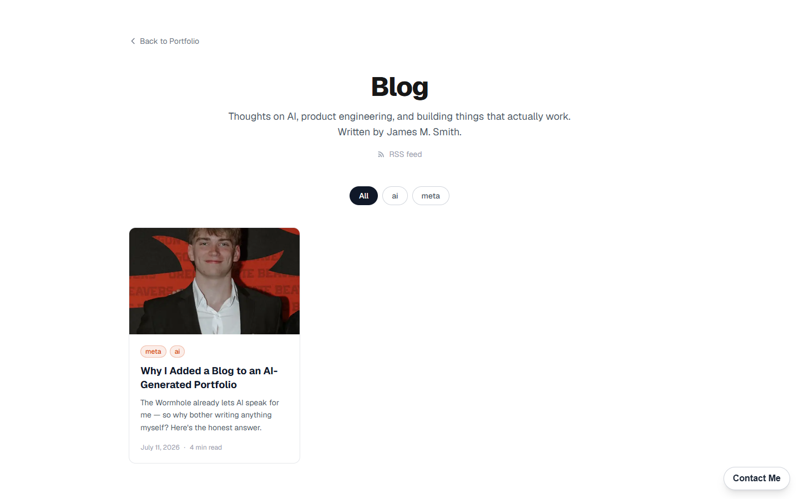
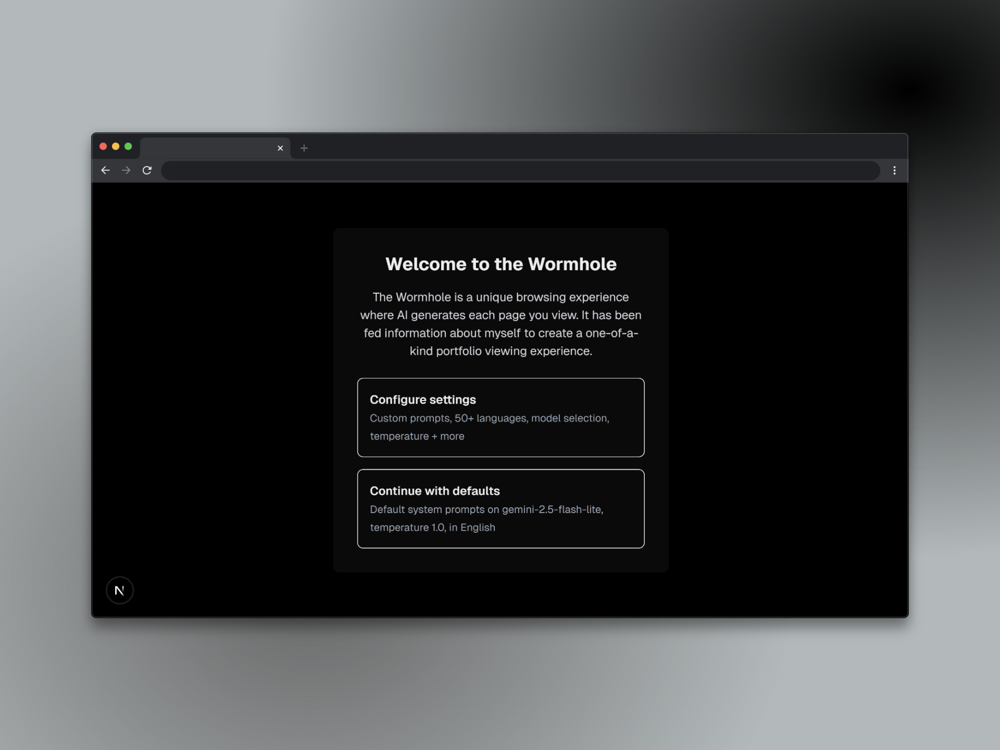

# j-m-s.dev — Wormhole & LLM Sandbox

<!-- hero -->

*j-m-s.dev: the AI-generated portfolio and 3D LLM sandbox.*

## 1. Snapshot
A portfolio that is itself a demo: the **Wormhole** — a catch-all route (`/wormhole/*`) where an LLM *generates every page as you browse* (no two visits alike), fed James's bio/résumé as context, with a **config UI** to pick provider/model (Gemini, OpenAI, Anthropic via Vercel AI SDK), language, temperature, and custom instructions; plus a static professional `/home` (experience, projects, education), **Playground → LLM Sandbox**: an interactive **3D learning lab (React Three Fiber / three.js)** visualizing **tokenization, embedding clustering, cosine similarity, and word-vector analogies (king − man + woman ≈ queen)** where an LLM assigns live 3D coordinates to arbitrary words; Cal.com **booking** page; **blog** (MDX); contact modal storing submissions in **Vercel Blob**; `llms.txt`/`agents.txt` for AI-crawler discoverability.

## 2. Headline numbers
| Number |
| --- |
| **92 commits**, Aug 11 2025 → Jul 12 2026 |
| ≈**5,400 lines** of TS/TSX |
| Next.js 15.4 (Turbopack) · React 19 · Tailwind 4 · three 0.185 / R3F 9 / drei 10 · Vercel AI SDK v4 · Zod · next-mdx-remote — package.json |
| Providers supported in Wormhole: Anthropic, Google, OpenAI (user key or env fallback) |

## 3. Accomplishments
- **LLM-generated site:** server route builds prompt from `info.md` + `system-instructions.txt`, returns raw HTML injected client-side; per-visitor provider/model/temperature config in `localStorage`; July 2026: refreshed model lineup with current small/cheap models, résumé fed to generator.
- **LLM Sandbox (Jun 30 2026):** production **WebGL context-loss fix for low-end GPUs**, hydration-mismatch fixes, **dependency dedup** (npm override forcing a single three.js — duplicate versions were crashing WebGL), 3D vector-space experience; Apr 2026 "graph relational mapping" (capstone relational-mapping HTML visualization).
- **Site overhaul (Jul 11–12, 2026):** current roles, EcoDues film in project demo tab, blog section, `llms.txt`, OpenBeavs sizzle reel, Magical + freelance logos, "ZDR note", landing conversion polish (single CTA row, grayscale hero headshot), Creative Works carousel (YouTube shorts).
- **Assets that double as a media library:** company logos, ELC/NJT/OSU photos, project thumbnails (this KB reuses them).

## 4. Resume-ready bullets
- Built an AI-generated portfolio (Next.js 15, React 19, Vercel AI SDK) that produces unique pages per visit across Anthropic, Gemini, and OpenAI models with user-selectable config.
- Built an interactive **3D LLM Sandbox** (React Three Fiber) visualizing tokenization, embeddings, cosine similarity, and word-vector analogies with live LLM-assigned coordinates; resolved production WebGL context loss on low-end GPUs and duplicate-three.js crashes.
**Short:** Portfolio that builds itself with an LLM + a 3D embedding playground (Next.js, R3F, AI SDK).

## 5. Keywords
Next.js App Router, React 19, TypeScript, Tailwind 4, Vercel AI SDK, multi-provider LLM, prompt templates, React Three Fiber, three.js, WebGL, embeddings visualization, MDX, Vercel Blob, Cal.com embed, SEO, llms.txt.

## 6. Soundbites
"I wanted people to *feel* what an embedding is — so you can type a word and watch a model place it in 3D space next to its neighbors."

## 7. Screenshots (captured 2026-10-20)
| | |
| --- | --- |
|  |  |
|  |  |
